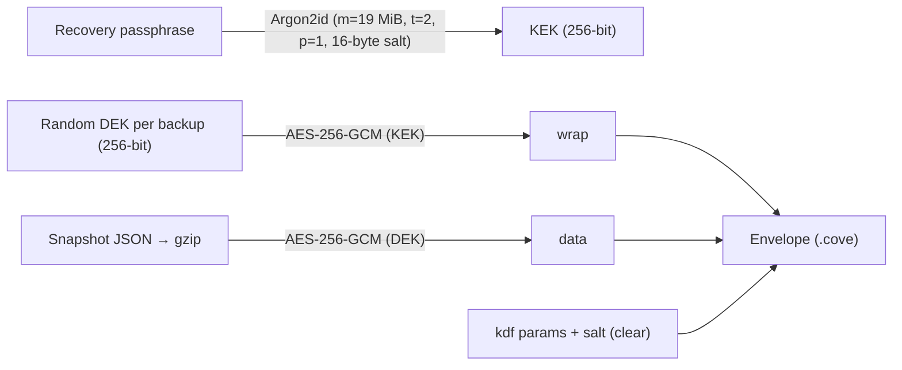

# Cove Backup & Recovery: Google Drive (E2EE) Decision Record

This document records how Cove backs up and restores a household's data, the security model behind it, and the operational setup it depends on.

---

## 1. Why Backup Exists Alongside Sync

Cove already keeps an encrypted event log in Supabase (`home_events`) and a full local copy on each partner's phone. That covers **one** lost phone: the partner's device still holds the home key and the server log can rebuild the other phone.

It does **not** cover:
- Both phones lost/reset at once (the home key exists only on devices, so the server log becomes unreadable).
- A single-member home (no partner device to re-pair from).
- Local-only state that never syncs (custom categories, tab order, read markers).

Google Drive backup closes this gap.

---

## 2. Product Decisions

| Decision | Choice | Rationale |
|---|---|---|
| Storage location | Google Drive **`appDataFolder`** (`drive.appdata` scope) | Hidden, app-private folder in the user's own Drive. Cove cannot read any other Drive files; users can't accidentally edit/delete backups; non-restricted scope (no paid security review). |
| Encryption model | **Recovery passphrase** (user-chosen, min 8 chars) | Only model that survives "both phones lost". Encrypting with the home key alone would make backups useless in exactly the scenario they exist for. |
| Passphrase entry | **Once per device** | The derived key (not the passphrase) is stored in Android Keystore-backed secure storage; subsequent backups need no prompt. Restoring on a new phone stores it automatically. |
| Forgotten passphrase | **Unrecoverable by design** | Zero-knowledge: Cove never sees the passphrase or derived key. UI warns to save it in a password manager. |
| Changing passphrase | Allowed; affects **future** backups only | Existing Drive backups stay locked with the passphrase they were made with. |
| Restore semantics | **Full replace** of local data, atomically | Predictable. Events that reached the server after the backup are replayed automatically from Supabase. |
| Retention | Newest **10** backups | Bounded Drive usage, enough history to roll back a bad day. |
| Platforms (v1) | **Android only** | Web shows "Available in the Cove Android app". iOS project does not exist yet. |
| Scheduling (v1) | **Manual** "Back Up Now" | Nightly background backup (WorkManager) is the planned follow-up. The previous fake "Nightly at 02:00 AM" UI was removed rather than kept as a lie. |

> [!IMPORTANT]
> **Honesty invariant:** backup UI must only ever show real state. No placeholder timestamps, counts or schedules. The previous mock (`BackupStatusNotifier`) was deleted for this reason.

---

## 3. Cryptographic Design

- **Envelope** (`BackupEnvelope`, UTF-8 JSON): `format`, `v`, `createdAt`, `schemaVersion`, `appVersion`, `kdf` (clear) + `wrap` and `data` (sealed).
- **AAD**: every GCM operation binds `cove-backup/v1` as associated data.
- **Wrong passphrase** fails fast on the tiny `wrap` blob (`BackupWrongPassphraseException`); tampering with `data` fails the GCM tag (`BackupFormatException`).
- Argon2id runs in a background isolate (`compute`) — ~160 ms on Apple Silicon, ~0.5–1 s on mid-range Android.
- Nothing in clear metadata reveals household content.

---

## 4. Snapshot Contents

`BackupSnapshotService` captures:
1. **Every Drift table**, read generically (`SELECT *`) inside one transaction for a point-in-time view. Raw SQLite values are preserved (blobs tagged `$b64`).
2. **All home symmetric keys** from `HomeKeyStore` (union of registered ids and `local_homes`).
3. **`cove_*` secure-storage preferences**, excluding `cove_home_key_*`, `cove_registered_home_ids` and `cove_backup_*`.

**Restore** (single transaction): `DELETE` + `INSERT OR REPLACE` per table, inserting only columns that exist in the current schema (forward-compatible with schema bumps). Backups from a **newer** schema are refused. After commit: `markTablesUpdated` wakes every stream (AuthGate transitions from onboarding to the app automatically), keys and prefs are written, active home is set, and `SyncEngineImpl.resyncAfterRestore` clears the in-memory dedupe cache and replays the server log.

---

## 5. User Flows

- **Settings → Backup & Restore**: Google Drive (Connect/Disconnect), Recovery Passphrase (set/change), Last Backup (real time + size), **Back Up Now**, **Restore**.
- **Back Up Now** chains: connect (if needed) → set passphrase (if needed) → upload → prune.
- **New phone**: Sign in → onboarding → **"Restore from Google Drive backup"** → pick backup → passphrase → review summary → restore.

---

## 6. One-Time Google Cloud Setup (required for Drive access)

Firebase project: `cove-home-app` (number `633452066662`).

1. **Enable the Drive API**: Google Cloud Console → APIs & Services → Library → *Google Drive API* → Enable.
2. **OAuth consent screen**: configure (External, Testing). Add scope `.../auth/drive.appdata`. Add both founders' Google accounts as **test users**.
3. **Android OAuth client**: Credentials → Create credentials → OAuth client ID → *Android*, package `com.app.cove`, SHA-1 of the signing key.
   - Debug/current release signing (debug keystore): `F9:7F:C3:B0:F5:85:C2:B2:10:5C:2C:5E:84:C8:7D:57:75:62:F1:00`
   - When a real upload/release keystore (or Play App Signing) is introduced, **add its SHA-1 as an additional Android client**, or Drive auth will fail with `DEVELOPER_ERROR`.
4. No code change or `google-services.json` update is required for authorization-only access.

---

## 7. Follow-ups

- Nightly automatic backup (WorkManager, Wi-Fi/charging constraints) using the stored KEK.
- Web support (Google Identity Services token client + web OAuth client).
- "Verify passphrase" reminder every few months so users don't forget it.

---

## 8. Code Map

| File | Responsibility |
|---|---|
| `lib/features/backup/backup_crypto.dart` | Argon2id KDF, AES-256-GCM envelope, gzip |
| `lib/features/backup/backup_snapshot_service.dart` | Generic DB/keys/prefs export & atomic restore |
| `lib/features/backup/drive_backup_remote.dart` | `BackupRemote` interface + Google Drive `appDataFolder` implementation |
| `lib/features/backup/drive_backup_controller.dart` | Riverpod state machine: connect, passphrase, backup, prune, restore |
| `lib/features/backup/drive_backup_section.dart` | Settings section + flow orchestration |
| `lib/features/backup/drive_backup_sheets.dart` | Passphrase sheet, restore sheet |
| `test/drive_backup_test.dart` | Crypto, snapshot and end-to-end controller tests (fake Drive) |
