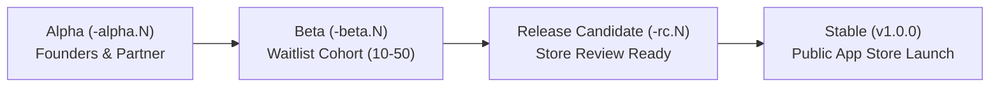
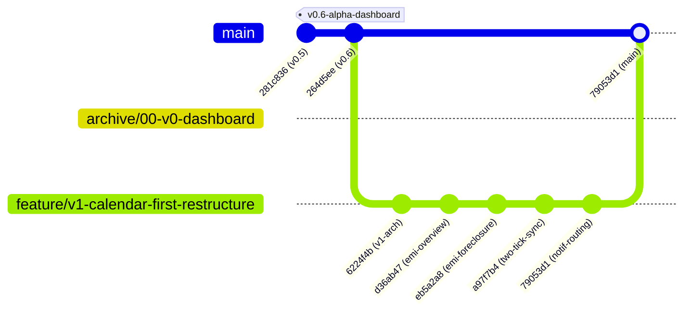

# Cove Product Engineering: Versioning Nomenclature, Git Tags & Archive Strategy

This document serves as the permanent reference and decision record for Cove's release nomenclature, semantic versioning standards, Git tagging conventions, and architectural backup/archive branch strategies.

---

## 1. Versioning Nomenclature & Philosophy

### 1.1 Semantic Versioning (SemVer) Structure
Cove follows the industry-standard Semantic Versioning 2.0 specification paired with Flutter's build number scheme:

$$\mathbf{MAJOR.MINOR.PATCH - PHASE.ITERATION + BUILD}$$

$$\text{Example: } \mathbf{1.0.0-alpha.1+1}$$

#### Anatomy Breakdown (`1.0.0-beta.2+15`):
- **`MAJOR` (`1`)**: Incremented when there is a major architectural overhaul, paradigm shift, or breaking data/UI restructuring (e.g. transitioning from the pre-v1 Dashboard era to the v1 Calendar-First Sanctuary).
- **`MINOR` (`0`)**: Incremented when new functional modules or substantial features are introduced in a backwards-compatible manner (e.g. adding the EMI Tracker, Routine System).
- **`PATCH` (`0`)**: Incremented for bug fixes, performance hardening, and polish passes that preserve existing functionality.
- **`PHASE` (`alpha` / `beta` / `rc`)**: Declares the operational readiness and user cohort of the release.
- **`ITERATION` (`1`, `2`, ...)**: Increments sequentially within that phase as fixes and iterations are shipped to that cohort.
- **`+BUILD` (`+1`, `+2`, ...)**: A strictly monotonic positive integer (`versionCode` on Android, `CFBundleVersion` on iOS). App Stores require this number to increase with every uploaded binary, completely independent of the display version.

---

### 1.2 Engineering Format vs. Consumer Display Format

| Context | Format | Example | Where Used |
|---|---|---|---|
| **Build & App Stores** | Full SemVer + Build | `1.0.0-alpha.1+1` | `pubspec.yaml`, Android Gradle, iOS Info.plist, TestFlight, Play Console |
| **In-App Display** | Clean Dropped `.0` | `v1.0-alpha.1 (1)` | About Cove screen, Settings, Profile footer |
| **Changelog & Timeline** | Curated Release Tag | `v1.0-alpha.1`, `v0.6-alpha` | `kChangelogItems`, What's Fresh modal, Release Notes |

> **Design Note (Apple / Spotify convention)**: In human-facing surfaces, trailing zero patches are dropped (e.g., `v1.0` instead of `v1.0.0`) to keep the typography calm, uncluttered, and editorial.

---

### 1.3 The Three Product Lifecycle Phases



#### 1. Alpha (`-alpha.N`) — Current Phase
- **Target Audience**: Founders (Saba & partner), plus 1–2 close household testers.
- **Purpose**: Rapid product iteration, live daily dogfooding, database schema migrations, and end-to-end sync stress testing.
- **Guarantees**: Zero-knowledge E2EE works, local SQLite persistence is active, but UI layouts and navigation paradigms may undergo radical shifts.
- **Naming**: `v0.1-alpha` through `v0.6-alpha`, currently **`v1.0-alpha.1`**.

#### 2. Beta (`-beta.N`)
- **Target Audience**: Private waitlist (10–50 households / couples).
- **Trigger**: When the core Calendar-First operating system, two-tick sync, offline reliability, and backup mechanisms have completed weeks of error-free daily use without a single desync.
- **Purpose**: Verify device fragmentation across diverse Android/iOS hardware, test edge-case network transitions (airplane mode, spotty cellular, battery saver kills), and validate partner onboarding flows.
- **Naming**: `v1.0.0-beta.1`, `v1.0.0-beta.2`, etc.

#### 3. Release Candidate (`-rc.N`) & Stable (`v1.0.0`)
- **Target Audience**: Public App Store & Google Play Store release.
- **Trigger**: Beta cohort reports zero data loss, crash-free session rate > 99.8%, and partner sync latency is under 1 second.
- **Naming**: `v1.0.0` (Stable public release).

---

### 1.4 App Store Version Independence
- **Starting Version**: There is **no requirement** to launch in the Play Store or App Store at `0.0.1`.
- Production apps can debut publicly on day 1 as **`v1.0.0`** (with build code `+1`).
- All internal engineering prototypes (`v0.1-alpha` through `v0.6-alpha`) and private test builds (`v1.0-alpha.N`) remain internal milestones and git milestones.

---

## 2. Cove's Historical Timeline & Alpha Progression

Every historical milestone in Cove's development was retroactively systematized under the `-alpha` taxonomy to accurately document that each step was tested live by the founders:

```
v0.1-alpha ──> v0.2-alpha ──> v0.3-alpha ──> v0.4-alpha ──> v0.5-alpha ──> v0.6-alpha ──> v1.0-alpha.1
(Foundation)   (E2EE Sync)    (Modules)      (Rhythms)      (Ergonomics)   (Helicopter)   (Calendar-First)
```

### Milestone Ledger

| Version | Release Date | Key Features & Architectural Milestones |
|---|---|---|
| **`v0.1-alpha`** | Sep 5, 2026 | **Foundation & Design System**: Drift SQLite on-device database, local-first reactive architecture, Bodoni Moda & General Sans typography, obsidian teal & linen oat palette. |
| **`v0.2-alpha`** | Sep 10, 2026 | **Zero-Knowledge Sync & Pairing**: Libsodium `crypto_secretbox_easy` client-side encryption, Supabase realtime outbox, QR home key exchange, two-tick sync. |
| **`v0.3-alpha`** | Sep 16, 2026 | **Shared Household Modules**: Shared lists with cross-partner checkmarks, multi-currency expenses with category tags, recurring subscriptions with monthly amortizations. |
| **`v0.4-alpha`** | Sep 17, 2026 | **Daily Rhythms & Indian Numbering**: Habit tracking with partner cheering, streak calculations, Indian numbering localization (`1,00,00,000`), strict month calendar bucketing. |
| **`v0.5-alpha`** | Sep 17, 2026 | **Domestic Ergonomics & Sync Hardening**: Partner activity attribution, silent background sync, soft-delete tombstone ledger, self-healing symmetric keys. |
| **`v0.6-alpha`** | Sep 17, 2026 | **Commitments Helicopter View & Profile Studio**: 12-month commitment projections, smart decimal rendering, custom avatar presets, user initials badge. |
| **`v1.0-alpha.1`** | Sep 19, 2026 | **Calendar-First Sanctuary Architecture**: Replaced standalone dashboard with calendar agenda hub, Today morning briefing, EMI Tracker with loan foreclosure and multi-select burden simulation, persistent delivery reconciliation, and direct push notification routing. |

---

## 3. Git Tags, Archive Branches & Backup Strategy

### 3.1 The Golden Rule: Zero-Destruction Architecture
When undergoing architectural transformations (such as replacing the v0.6 Dashboard with the v1.0 Calendar-First Sanctuary), code must **never be deleted without creating permanent, immutable snapshots**.

---

### 3.2 The Pre-Overhaul Snapshot Artifacts
Before executing the Calendar-First restructure at commit `264d5ee`:

1. **Git Tag**:
   ```bash
   git tag -a v0.6-alpha-dashboard -m "Snapshot of v0.6-alpha before calendar-first restructure"
   ```
   - **Purpose**: Creates an immutable point-in-time reference directly in git history. Tags cannot be modified accidentally and can be checked out at any second.

2. **Archive Branch**:
   ```bash
   git branch archive/00-v0-dashboard 264d5ee
   ```
   - **Purpose**: Preserves the complete, buildable pre-restructure application tree in an isolated named branch.

---

### 3.3 Archive Branch Naming Conventions
For all future major overhauls, archive branches follow a chronological zero-padded numbering pattern:

```
archive/00-v0-dashboard
archive/01-v1-calendar-first
archive/02-v2-...
```

#### Benefits:
- Running `git branch -a` or viewing branches in GitHub/IDE automatically sorts archive snapshots in exact chronological order.
- Provides a clear safety net where legacy UI screens, widgets, and business logic can be referenced or revived without digging through raw commit hashes.

---

### 3.4 Active Development & Main Branch Flow



- **`main`**: The single source of truth for production-ready code. Pushing to `origin/main` automatically triggers Vercel to build and publish Flutter Web (`./build.sh`).
- **`feature/*`**: Dedicated feature branches where extensive development, testing, and multi-device APK builds are validated before merging.
- **Fast-Forward Merges (`--ff-only`)**: When history is linear, fast-forward merges keep the commit graph clean, traceable, and bisectable.

---

### 3.5 Recovery Playbook: How to Access or Restore Archived Code

#### Scenario A: Inspect or run the legacy Dashboard code
```bash
# Checkout the archived dashboard branch in a detached or temporary state
git checkout archive/00-v0-dashboard

# Run tests or launch the legacy app
flutter run
```

#### Scenario B: Extract a single legacy widget or controller into the current branch
```bash
# Checkout just the specific legacy file from the archive tag into your current branch
git checkout v0.6-alpha-dashboard -- lib/features/dashboard/dashboard_screen.dart
```

#### Scenario C: View difference between legacy dashboard and current architecture
```bash
git diff v0.6-alpha-dashboard..main --stat
```

---

## 4. Single Source of Truth Synchronization Checklist

Whenever a new version or phase iteration is declared, the following files **must be updated in lockstep**:

1. **`pubspec.yaml`**:
   - `version: X.Y.Z-phase.N+BUILD` (e.g. `1.0.0-alpha.1+1`)
2. **`lib/features/changelog/changelog_models.dart`**:
   - `kCoveCurrentAppVersion`: Update to the active version string (e.g. `'1.0.0-alpha.1'`).
   - `kChangelogItems`: Add or update the latest item with its human-readable release date, category, outcome statement, and technical highlights.
3. **`lib/features/home/about_cove_screen.dart`**:
   - Ensures UI displays the exact version and build code to users.
4. **Git Tag**:
   - Run `git tag -a vX.Y-phase.N -m "Release description"` and push tags with `git push origin --tags`.
